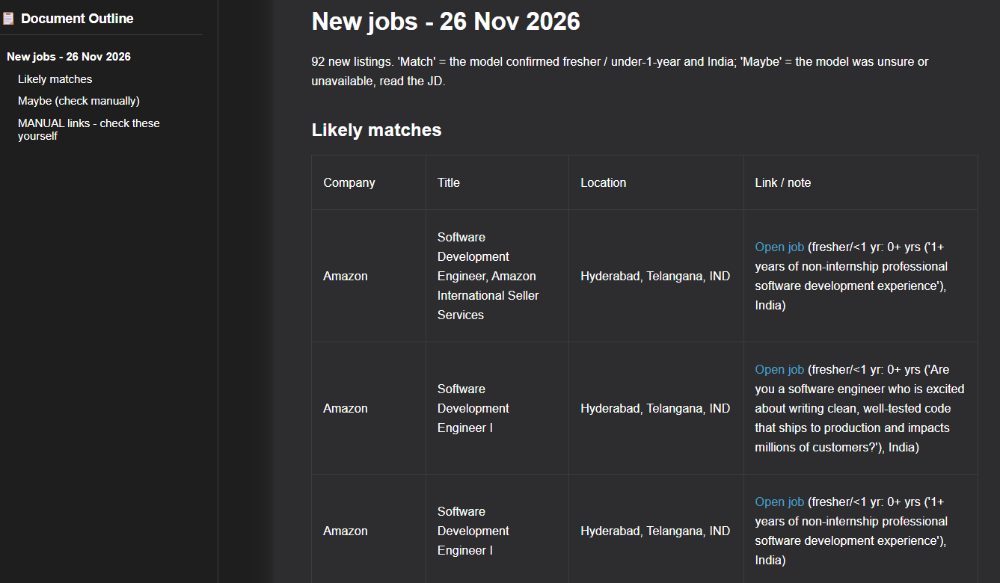

# Job Finder
 
Tired of opening 100 career pages every week? **Job Finder checks them for you.** It reads the public job boards of 100+ companies, keeps only the jobs that match **your** titles, locations and experience level, and saves just the **new** ones to a Word file with clickable links. You spend your time applying, not searching.
 
It works for any career stage. It ships tuned for fresher roles (0-1 years) in India, and you change the target in one file, `config.yaml`: job titles, words to avoid, experience limit, locations and companies. An optional small AI model, running on your own computer, double-checks the experience and location so fewer wrong jobs reach you. **It never applies to anything.** You open the Word file and apply by hand.
 
## Contents
- [How it works](#how-it-works)
- [Pick your setup](#pick-your-setup)
- [1. Install](#1-install)
- [2. Check the company list](#2-check-the-company-list-one-time)
- [3. Run it](#3-run-it)
- [Option A: rules only](#option-a-rules-only-no-ai-check)
- [Option B: AI check on your own computer (Ollama)](#option-b-ai-check-on-your-own-computer-ollama)
- [Option C: AI check on Google Colab's GPU](#option-c-ai-check-on-google-colabs-gpu)
- [Configuration](#configuration-configyaml)
- [Example setups](#example-setups)
- [Output files](#output-files)
- [Command-line options](#command-line-options)
- [Run it automatically](#run-it-automatically)
- [Troubleshooting](#troubleshooting)
- [Notes and limits](#notes-and-limits)
- [Contributing](#contributing)
## How it works
 
1. **Fetch.** Pulls open jobs from every company in `config.yaml`, in parallel.
2. **Rules (no AI).** Cheap checks drop most jobs straight away:
   - the title must match one of your `titles` and none of your `exclude_title_words` (senior, lead, manager...)
   - titles with a level above entry level ("Engineer II", "Level 5") are dropped
   - the location must be in your `locations` list (whole-word match, so "India" never matches "Indiana")
   - if the location is vague ("2 Locations"), the job text must mention one of your locations
   - the job text is scanned for the experience wording ("3+ years of experience" is dropped, "freshers welcome" is kept)
3. **AI check (optional).** Jobs that pass the rules are read by a small local model (`qwen2.5:3b` through [Ollama](https://ollama.com)). It answers two questions: *does this job ask for fewer than your `max_years_experience` years?* and *is the job in one of your `locations`?*
4. **Verdict.**
| Verdict | Meaning |
|---|---|
| **Match** | Clearly fits. Listed under "Likely matches". |
| **Maybe** | The job text doesn't say, or the model was unsure or unavailable. Listed under "Maybe (check manually)". |
| *(dropped)* | Clearly doesn't fit. Not listed. |
 
Built-in safety: the model can only drop a job if the exact sentence it quotes really appears in the job text. A made-up quote, a timeout or a bad answer turns into "Maybe", never a silent drop.
 
## Pick your setup
 
| | Option A: rules only | Option B: Ollama on your computer | Option C: Ollama on Colab GPU |
|---|---|---|---|
| Setup effort | none | install Ollama + download a 2 GB model | run a notebook + paste a URL |
| Accuracy | good, more "Maybe"s | best | best |
| Speed | fastest | seconds per job with a GPU or Apple Silicon Mac, about a minute or more per job on a CPU | seconds per job |
| Needs | Python | Python + about 4 GB free memory | Python + a Google account |
 
You only need the model for the **first run**, which checks every job that passes the rules. After that, answers are saved, so later runs only check *new* postings and are quick even on a CPU.
 
## 1. Install
 
You need **Python 3.10+** from [python.org](https://www.python.org/downloads/) (on Windows, tick "Add Python to PATH"). Check with `python --version` (Mac/Linux: `python3 --version`).
 
```bash
git clone https://github.com/Rishav9911/job-script.git
cd job-script
pip install -r requirements.txt
```
 
## 2. Check the company list (one time)
 
```bash
python job_finder.py --check
```
 
Each company shows `[OK]`, `[FAIL]` or `[manual]`. To fix a `[FAIL]`, see [Adding or fixing companies](#adding-or-fixing-companies).
 
## 3. Run it
 
Pick one option below, then run:
 
```bash
python job_finder.py
```
 
Results are written to the `output` folder.
 
### Option A: rules only (no AI check)
 
Nothing to set up:
 
```bash
python job_finder.py --no-model
```
 
Jobs that don't state the experience end up under "Maybe".
 
If you run the script *without* `--no-model` and Ollama isn't running, it prints a warning and continues with the rules only, so you always get results.
 
### Option B: AI check on your own computer (Ollama)
 
**One-time setup**
 
1. Install Ollama from [ollama.com/download](https://ollama.com/download) (Windows, Mac, Linux). On Windows and Mac it runs in the background after install. On Linux, run `ollama serve` if it isn't already running.
2. Download the model (about 2 GB, needs roughly 4 GB of free memory):
```bash
ollama pull qwen2.5:3b
```
3. In `config.yaml`, make sure these are set:
```yaml
use_model: true
ollama_model: qwen2.5:3b
ollama_url: http://localhost:11434
max_runtime_minutes: 600      # a slow first run can take hours
```
4. Check it works, and see how fast it is on your computer:
```bash
python job_finder.py --test "Software Engineer" --loc "Bengaluru, India" --desc "Requirements: 0-1 years of experience. Bengaluru office."
```
   Run it twice. The line `[model #1] 12s ...` shows the seconds per job. The second run is the real speed, because the first one includes loading the model.
 
**How long will it take?**
 
- **First run:** the model checks every job that passes the rules (about 90 in the author's run). With a GPU or an Apple Silicon Mac that is seconds per job. On a CPU it can be about a minute or more per job, so leave it running (an hour or more is possible).
- **Later runs:** only new postings are checked, so a run every few days is quick. Keep `output/model_cache.json` and `output/seen.json` (see [Output files](#output-files)).
**Too slow?** Lower `model_jd_chars` (for example `2500`) so less text is sent per job, or use [Option C](#option-c-ai-check-on-google-colabs-gpu) for the first run.
 
### Option C: AI check on Google Colab's GPU
 
Colab gives you a free GPU, so the model answers in seconds. The job fetching still runs **on your own computer**. Only the model runs on Colab, and a small tunnel connects the two. (Don't run the whole script on Colab: Workday often blocks Colab's shared IP addresses.)
 
1. Open [colab.research.google.com](https://colab.research.google.com), then **File > Upload notebook** and choose `job_finder.ipynb` from this repo.
2. Set **Runtime > Change runtime type > T4 GPU**, then save.
3. Run the cells in order, waiting for each to finish:
   - **Cell 1:** installs Ollama
   - **Cell 2:** starts Ollama and downloads the model
   - **Cell 3:** a watchdog that restarts Ollama if it crashes
   - **Cell 4:** opens the tunnel and **prints an address** like `https://something-random.trycloudflare.com`
4. Copy that address into `config.yaml` on your computer:
```yaml
ollama_url: https://something-random.trycloudflare.com
```
5. Run `python job_finder.py` on your computer. You should see `[model] ON` and `[model #N] 1s ...` lines.
**Things to know about Colab**
- **Keep the Colab tab open** while the script runs. Free Colab disconnects idle sessions and limits GPU time.
- The address **changes every time** you restart the tunnel, so update `ollama_url` each time.
- **Don't share or commit the address.** Anyone who has it can use your Colab model while it's open. After you finish, switch `ollama_url` back to `http://localhost:11434`.
- If the GPU isn't available, try again later, or use Option A or B.
## Configuration (`config.yaml`)
 
Everything you can change lives in one file, `config.yaml`. Open it in any text editor, change it, save it, and run the script again. Lines starting with `#` are comments. In YAML, indentation matters and list items start with `- `.
 
The settings are grouped by what they do. The defaults are tuned for fresher roles in India, so change them to fit what **you** want.
 
### What jobs to look for
 
**`titles`** (required): a job's title must contain at least one of these.
- Capitals don't matter. Matching is from the start of a word, so `engineer` also matches "Engineering".
- Related titles are added for you: `software engineer` also covers "software development engineer" and "software developer", `ai engineer` also covers "artificial intelligence engineer", and `ml engineer` also covers "machine learning engineer".
- Each title is also used as a search on the company sites that have a search feature (Workday, Oracle, SmartRecruiters, Amazon). A long list means more searches and a slower run, so keep it to the roles you really want.
```yaml
titles:
  - software engineer
  - data engineer
  - backend engineer
```
 
**`exclude_title_words`**: skip any job whose title contains one of these words or phrases.
- A word longer than 3 letters matches the start of a word: `lead` also skips "Leadership", and `test` also skips "Testing".
- A word of 3 letters or fewer must match exactly: `it` skips "IT Support" but not "Item Developer".
- Phrases work too, for example `head of`.
```yaml
exclude_title_words:
  - manager
  - intern
  - contract
```
 
**`use_builtin_exclusions`** (default `true`): also skips titles containing *senior, sr, staff, principal, lead, manager, director, head of, architect, vp, vice president, distinguished, fellow*, on top of your own list. Set it to `false` if you **want** senior roles (then list the words you want to avoid in `exclude_title_words`).
 
**`exclude_senior_levels`** (default `true`): skips titles that name a level above entry, like "Engineer II", "SDE 3", "Software Engineer 4" or "Level 5". "Engineer I", "SDE 1" and "Level 1" are kept. Set it to `false` if you want mid-level roles.
 
**`exclude_description_words`** (default none): skip a job if its description contains any of these phrases, for example `security clearance` or `us citizen`. This is a plain text match (not whole-word), so keep the phrases specific.
 
### Experience
 
**`max_years_experience`** (default `1`): the highest experience requirement you accept.
- The script reads phrases like "3+ years of experience" in the job text. A range like "3-5 years" counts as 3. Phrases such as "preferred" or years the company has existed are not meant to count.
- With the AI check on, a job must ask for **fewer than** this number (`1` keeps 0-1 year roles and drops "1+ years"). In rules-only mode the limit is **inclusive**.
- Jobs that don't state any years: if the title or text uses entry-level wording (fresher, new grad, graduate, entry level, early career, campus, intern, trainee, associate, "Engineer I", "SDE 1"), they are a **Match**. Otherwise they go under **Maybe**.
- There is only an upper limit, no minimum. If you set `5`, you also get roles asking for 0-4 years.
| You want | Set |
|---|---|
| Freshers | `1` |
| Up to 3 years | `3` (or `4` to include "3 years" with the AI check on) |
| Up to 5 years | `5` |
 
### Where
 
**`locations`** (default none, which keeps every location): the job's location must contain one of these.
- Matching is whole-word, so `india` does **not** match "Indiana". Use countries, states or cities.
- `bengaluru` also covers `bangalore`, and `gurugram` also covers `gurgaon`.
- If a job's location is vague ("2 Locations", "Multiple locations", or empty), the script looks in the job's title, text and link for one of your locations. If none is mentioned, the job is dropped. Workday jobs get their real locations read from the job page first.
- `locations: []` turns the location filter off.
```yaml
locations:
  - bengaluru
  - hyderabad
  - india
```
 
The AI check uses this same list, so it works for any country. Two tips:
- List the **country as well as the cities** (for example `germany`, `berlin`, `munich`). It gives the model an easy match for jobs that only name the country.
- If you change `locations`, delete `output/model_cache.json`. The saved answers were made for the old list. (Your experience answers are still fine; deleting just re-asks them.)
### Which companies
 
**`companies`**: the list of companies to scan. See [Adding or fixing companies](#adding-or-fixing-companies) below.
 
### The AI check
 
**`use_model`** (default `true`): `false` means rules only, the same as running with `--no-model`. If it is `true` but Ollama can't be reached, the script warns you and continues with rules only.
 
**`ollama_model`** (default `qwen2.5:3b`): the model to use. `qwen2.5:7b` (roughly 5 GB) is more reliable on tricky wording but slower. Download it first with `ollama pull <name>`. Answers are saved per model, so changing the model starts a fresh cache.
 
**`ollama_url`** (default `http://localhost:11434`): where Ollama is running. Leave it for your own computer. For Colab, paste the address the notebook prints (see [Option C](#option-c-ai-check-on-google-colabs-gpu)).
 
**`model_timeout_seconds`** (default `180`): give up on one job after this long. That job is listed as **Maybe**.
 
**`model_jd_chars`** (default `3500`): how many characters of the job text are sent to the model, trimmed around the requirements, experience and location parts. Lower it (for example `2500`) to speed up a slow CPU. Raise it if the model seems to miss details.
 
### Speed and politeness
 
**`max_runtime_minutes`** (default `90`): after this long, no new companies are started and the model isn't asked any more. Jobs not yet checked are listed as **Maybe**. Raise it (for example `600`) for a slow first run.
 
**`workday_parallel`** (default `6`) and **`workday_gap_seconds`** (default `0.15`): how fast Workday sites are queried (all Workday companies share this limit). If you see many `429 Too Many Requests` errors, lower the first (try `2`) and raise the second (try `0.4`).
 
### Output
 
**`output_dir`** (default `output`): the folder for the Word file, `seen.json` and `model_cache.json`.
 
### Example setups
 
**Fresher in India (the default)**
```yaml
titles: [software engineer, data engineer]
max_years_experience: 1
locations: [bengaluru, hyderabad, pune, india]
```
 
**Up to 5 years, senior titles allowed**
```yaml
titles: [software engineer, backend engineer, data engineer]
max_years_experience: 5
use_builtin_exclusions: false     # allow "senior", "lead", ...
exclude_senior_levels: false      # allow "Engineer II / III"
exclude_title_words: [manager, director, intern, contract]
locations: [bengaluru, hyderabad]
```
 
**Another country, or anywhere**
```yaml
titles: [software engineer]
max_years_experience: 3
locations: [germany, berlin, munich]   # or [] for no location filter
```
 
### Adding or fixing companies
 
| `source` | Fields | Where to find them |
|---|---|---|
| `greenhouse` | `board` | Careers URL like `boards.greenhouse.io/<board>/jobs/...` |
| `lever` | `board` | `jobs.lever.co/<board>` |
| `ashby` | `board` | `jobs.ashbyhq.com/<board>` |
| `smartrecruiters` | `board`, optional `country: in` | `jobs.smartrecruiters.com/<board>` |
| `workday` | `host`, `tenant`, `site` | URL `https://<host>/<site>`. `tenant` is the first part of `host`; `site` is the part after `/en-US/` if present |
| `oracle` | `host`, `site` | URL `https://<host>/hcmUI/CandidateExperience/en/sites/<site>/...` |
| `amazon` | optional `location`, `country` | Built in |
| `atlassian` | none | Built in |
| `manual` | `url` | Any careers search page. It is listed at the end of the Word file for you to open yourself. |
 
Re-run `python job_finder.py --check` until the companies you care about show `[OK]`. If a company moved to another system, switch it to `source: manual`.
 
## Output files
 
Everything is written to the `output` folder. It is git-ignored, so it stays on your computer.
 
| File | What it is |
|---|---|
| `jobs_<date>_<time>.docx` | New jobs only: **Likely matches**, **Maybe (check manually)**, and a **MANUAL links** list |
| `seen.json` | Links of jobs already shown to you. They never appear again. Delete this file to see everything again. |
| `model_cache.json` | The model's saved answers, so a job is never asked twice. Delete it to re-ask everything. |
 
Jobs that were *dropped* are not saved in `seen.json`, so they are re-checked on every run. This is fast thanks to the cache, and it means a rule change can bring them back.

This is how the output would look for you: 


 
## Command-line options
 
| Option | What it does |
|---|---|
| `--no-model` | Rules only, no AI check |
| `--check` | Test every company and exit |
| `--test "TITLE" --loc "..." --desc "..."` | Show how one job would be judged (also times the model) |
| `--debug` | Print why each matching-title job was dropped |
| `--workers N` | Companies fetched in parallel (default 24) |
| `-c other.yaml` | Use a different config file |
| `--inspect <Oracle job link>` | Show exactly what the script reads for one Oracle job (for debugging) |
 
## Run it automatically
 
Your computer must be on at the scheduled time. If you use Option B, Ollama must be running too. If it isn't, the script warns and falls back to rules only.
 
**Windows (Task Scheduler)**
1. Create Basic Task, name it "Job finder", choose Daily (or every few days), pick a time.
2. Action: Start a program. Program: the full path to `python.exe` (find it with `where python`). Arguments: `job_finder.py`. Start in: your project folder.
3. In the task's Properties, tick "Run task as soon as possible after a scheduled start is missed".
**Mac / Linux (cron)**
```bash
crontab -e
0 1 * * * cd /path/to/job-script && /usr/bin/python3 job_finder.py >> run.log 2>&1
```
 
## Troubleshooting
 
| What you see | What to do |
|---|---|
| `[model WARNING] cannot reach Ollama` | Start Ollama (open the app, or `ollama serve`), then run again. Or keep going with the rules only. |
| `[model WARNING] model ... is not downloaded` | Run `ollama pull qwen2.5:3b` |
| Many `429 Too Many Requests` from Workday | Lower `workday_parallel` (try `2`) and raise `workday_gap_seconds` (try `0.4`). Run from your own computer, not Colab. |
| `[model failed, try 1/3]` | Ollama crashed or is busy. The script retries 3 times. After 5 jobs fail in a row the model is switched off for that run and the rest become "Maybe". Fix Ollama, delete `output/seen.json`, and run again. |
| The first run stopped early | `max_runtime_minutes` ran out. Unchecked jobs become "Maybe". Raise it (for example `600`) and delete `output/seen.json`. |
| A company shows `[FAIL]` | Fix `board` / `host` / `site` in `config.yaml` (see [Adding or fixing companies](#adding-or-fixing-companies)) |
| A wrong job slipped through, or a good one was dropped | Run with `--debug`, or `--test` with the job's title, location and text, and open an issue |
 
## Notes and limits
 
- It uses companies' **public** job-board feeds. Keep `--workers` and the Workday settings modest, and be kind to their servers.
- A small model can still be wrong. That is why unclear jobs go to "Maybe" instead of being hidden.
- Job sites change. If a company stops returning jobs, `--check` will show it.
- Always read the job description before you apply.
## Contributing
 
Suggestions and pull requests are welcome. Good things to contribute:
 
- new companies, or fixes for ones that stopped working
- support for another job-board system
- better rules for titles, locations or experience wording
- an optional *minimum* experience filter (today there is only an upper limit)
- bug reports with the company name and the `--test` or `--debug` output
To contribute: fork the repo, create a branch, make your change, run `python job_finder.py --check` and a `--test` example, then open a pull request. For bigger changes, please open an issue first so we can talk it through.
 